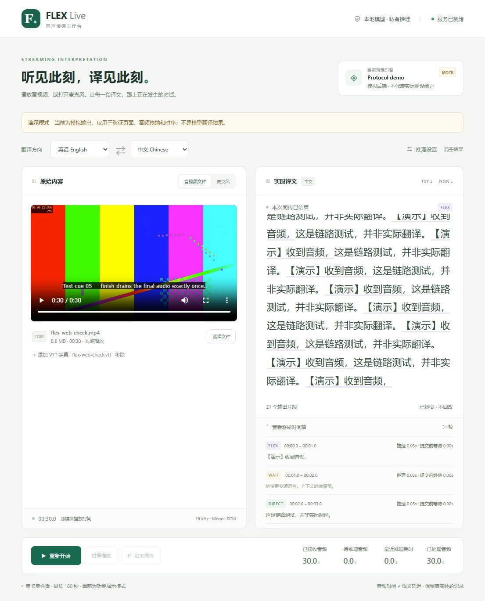

# FLEX · 本地模型同声传译系统

FLEX Live 是面向 SFT 后双向中英 Qwen3-Omni 模型的流式推理系统，提供单音频命令行和 Web 两种入口。Web 页面左侧播放音视频或采集麦克风，右侧显示增量译文，并单独记录 WAIT / FLEX / DIRECT 策略与处理时间。一个本地 checkpoint 支持中→英、英→中两个方向，不调用第三方翻译 API，不做 TTS。

媒体文件留在浏览器，**只有实际播放到的音频**以 PCM 帧发送给部署此服务的 GPU 服务器；视频画面、完整媒体文件和字幕文件不上传。视频烧录字幕或另选的 WebVTT 字幕可用于人工对照翻译时机。

本仓库发布独立的 Web 推理系统及单音频推理入口，不包含模型权重、训练数据、数据准备/训练脚本或蒸馏 prompt。前端无需 Node 构建；Node 仅用于音频处理逻辑测试。

> 当前版本：有界会话、单模型、单活动会话。目标部署是一张 A800 80 GB；CPU 自动化测试与浏览器 mock 链路已经验证，真实 checkpoint 的显存、吞吐和翻译质量仍需在目标服务器验收。mock 不是语音翻译模型。



*截图为明确标注的 mock 模式，使用合成测试视频和演示文本，不代表真实翻译质量。*

## 功能概览

- 麦克风实时输入，以及本地音频/视频按播放进度输入。
- 同一个双向 checkpoint 切换中→英、英→中，每次启动建立独立会话。
- 译文只追加，不回滚；正文不显示协议标签，时间线保留策略与时间记录。
- 基础音频块、积压合并、队列上限、尾块处理与异常停止。
- TXT 纯译文导出、JSON 完整事件导出，以及可关闭的服务端 JSONL 日志。
- FastAPI + WebSocket 后端，无前端构建步骤；安全上下文使用 AudioWorklet，内网 HTTP 文件模式自动选择兼容采集。

| 模型响应 | 右侧译文正文 | 策略记录与模型历史 |
|---|---|---|
| `<\|WAIT\|>` | 不追加内容，保留此前译文 | 保留 WAIT |
| `<\|FLEX\|>新增译文` | 立即追加新增译文，不显示标签 | 保留 FLEX 与原始响应 |
| `<\|DIRECT\|>新增译文` | 立即追加新增译文，不显示标签 | 保留 DIRECT 与原始响应 |

FLEX 译文不是可以事后改写的草稿；与 DIRECT 一样，输出后就进入已提交历史。策略由训练后的模型决定，服务端只做协议校验，不根据句子长短或完整程度擅自重标。

## 获取代码与文档导航

```bash
git clone https://github.com/caiqiezujian/FLEX.git
cd FLEX
```

仓库根目录即应用根目录，后面的命令在此目录执行。

- [真实模型启动](#1-先用真实模型启动) / [无 GPU 演示](#2-无-gpu-的功能演示)
- [先做单音频流式 S2TT，不启动网页](docs/S2TT.md)
- [客户端/服务端协议](docs/PROTOCOL.md)
- [已完成的验证与未验证边界](docs/VALIDATION.md)
- [开发与测试](CONTRIBUTING.md)
- [部署安全与数据隐私](SECURITY.md)

## 先验证模型：单音频 → 流式译文

如果暂时不需要平台，可以直接运行 `infer_audio.py`。它复用同一模型适配层，但**不启动 Web 服务，不需要浏览器，也不需要 FastAPI**。先把音频放到 GPU 服务器，再指定本地文件路径：

```bash
python -m pip install -r requirements-infer.txt
CUDA_VISIBLE_DEVICES=0 python infer_audio.py \
  --model /absolute/path/to/checkpoint-merged \
  --audio /absolute/path/to/english.wav \
  --direction en-zh \
  --chunk-seconds 1 \
  --pace realtime \
  --output-dir outputs/en-zh-first
```

默认按真实时间逐块释放音频；`--pace fast` 取消时间等待，但仍逐块推理，不会把完整音频交给模型。中→英使用 `--direction zh-en`。终端增量显示译文，输出目录保存 `translation.txt` 和 `events.jsonl`；目录必须是新路径，避免覆盖前一次结果。16 kHz 单声道 PCM16 WAV 无需额外解码器，MP3/FLAC/其他采样率文件通过 FFmpeg 流式转换。

模型准备、协议形式、积压含义、尾块与错误处理见 [单音频 S2TT 使用说明](docs/S2TT.md)。GPU/CUDA 依赖仍需复用已经跑通模型的环境；`requirements-infer.txt` 不替代完整模型环境。

## 1. 先用真实模型启动

运行位置：Linux GPU 服务器，配置目标为一张 A800 80 GB。使用已经跑通 Qwen3-Omni 推理的 Python / CUDA / vLLM 环境。适配代码面向 **vLLM 0.11.1** 接口，尤其依赖其多模态输入预处理接口；没有声称兼容所有最新版 vLLM。

`requirements.txt` 只安装 Web/CPU 依赖，**不安装或替换 torch、transformers、vLLM 与 CUDA**。真实模型需要自行准备完整 merged checkpoint 及其训练时匹配的 tokenizer/processor；原始基座模型不会因为套上这个界面就自动具备三标签同传能力。

```bash
cd /path/to/FLEX
python -m pip install -r requirements.txt
CUDA_VISIBLE_DEVICES=0 bash start_server.sh /absolute/path/to/checkpoint-merged
```

或直接运行：

```bash
CUDA_VISIBLE_DEVICES=0 python run.py \
  --backend vllm \
  --model /absolute/path/to/checkpoint-merged \
  --host 127.0.0.1 --port 8000 \
  --protocol-form special \
  --dtype bfloat16 \
  --gpu-memory-utilization 0.90 \
  --max-model-len 8192 \
  --max-audio-turns 256 \
  --max-tokens 160 \
  --chunk-seconds 1 \
  --max-chunk-seconds 3 \
  --max-pending-seconds 12 \
  --max-session-seconds 180
```

注意：上面 `special` 只适用于真正按三个 special token 训练并正确保存 tokenizer 的 checkpoint。历史 text-form 模型改用 `--protocol-form text`；默认 `auto` 只检查 tokenizer 的表现，**不能证明模型权重的训练形式**。服务不会替你新增协议 token 或修改模型文件。模型必须是完整 merged 权重及匹配的 tokenizer/processor，不是仅 LoRA adapter。

只加载一个双向 checkpoint；选择中→英或英→中会换目标语言 system prompt、重新建立会话，不会加载第二份模型。推理沿用 SFT 多轮音频协议：每块音频一个 user 轮，每个 WAIT/FLEX/DIRECT 响应原样回填历史。

模型初始化和预热完成前不要开始播放。服务只运行一个 worker、一次一个活动会话。**不要用 `uvicorn --workers 2` 或 `--reload` 包装真实模型**，否则可能重复占用显存。

### 在你自己的电脑打开服务器页面

**内网 HTTP：直接播放音视频文件并同传，无需 SSH 或浏览器 flags。** 在服务器设置自己的访问口令，然后启动：

```bash
export FLEX_ACCESS_TOKEN='replace-with-your-own-long-random-secret'
CUDA_VISIBLE_DEVICES=6 bash start_server.sh /absolute/path/to/checkpoint-merged \
  --host 0.0.0.0 --port 18889
```

同事在 Chrome / Edge 打开 `http://服务器真实内网IP:18889`，在“推理设置 → 服务访问令牌”中填写同一口令，选择音视频文件并开始。`0.0.0.0` 是服务器监听地址，不是浏览器访问地址；Docker 部署还需将该端口映射到宿主机。`CUDA_VISIBLE_DEVICES=6` 选择物理 GPU 6，不需要再传 `cuda:6`。

普通远程 HTTP 的文件模式会使用 `ScriptProcessorNode` 兼容采集，仍只发送实际播放的音频，不预上传完整文件。页面/导出记录会标明采集方式。该兼容接口已被浏览器标准弃用、依赖主线程，适合受控内网试用；请保持页面在前台，不保证后台标签页、任意浏览器或任意媒体编码都可用。采集发生明显延后或不连续会报错停止，不静默跳过音频。

**麦克风与文件模式不同：普通远程 HTTP 默认不能调用麦克风。** 麦克风请使用可信 HTTPS，或下面的 localhost 访问方式；文件模式不再被这个检查一并拦截。HTTP 不加密口令和音频，仅在受控可信网络测试，敏感内容和长期共享部署使用 HTTPS；不要开放到公网。

如果需要麦克风，也可以使用 SSH 隧道，服务器保持回环监听：

```bash
ssh -L 8000:127.0.0.1:8000 your_user@your_gpu_server
```

然后在本机 Chrome / Edge 打开 `http://localhost:8000`。这是可选的麦克风/安全访问方式，不是内网文件同传的必需步骤。若服务器端口为 18889，相应使用 `ssh -L 18889:127.0.0.1:18889 your_user@your_gpu_server` 和 `http://localhost:18889`。

长期共享使用或需要直接远程采集麦克风时，部署可信 HTTPS/WSS 反向代理、配置认证和网络访问控制：

```bash
export FLEX_ACCESS_TOKEN='replace-with-a-long-random-secret'
CUDA_VISIBLE_DEVICES=0 python run.py --model /absolute/merged \
  --host 0.0.0.0 --port 8000 \
  --allow-origin https://flex.example.internal
```

页面将要求输入访问口令。口令不放 URL，不写进服务事件日志。反向代理必须转发 WebSocket Upgrade、保留 Host，设置足够的读超时，并正确处理可信代理头。没有部署和访问授权时不要自行开放公网端口。

## 2. 无 GPU 的功能演示

```bash
python -m pip install -r requirements.txt
python run.py --backend mock --host 127.0.0.1 --port 8000
```

此模式可验证选文件、真实音视频播放、PCM 传输、暂停/结束、界面、导出和协议，但**不识别也不翻译语音**。页面和输出内容都会明确标注“演示”。切换 `--backend vllm --model ...` 才是真实同传，不能拿演示结果评估翻译质量。

## 3. 使用方法

1. 选择“音视频文件”或“麦克风”，选好中英方向和基础 chunk（建议先 1 秒）。文件选择发生在本地，不预上传完整媒体。麦克风使用浏览器/系统当前选定的输入设备，需要用户授权。
2. 文件模式可选浏览器支持的 MP4/WebM/WAV/MP3 等文件。视频在左侧实际播放；烧录字幕直接可见，也支持另选本地 WebVTT 字幕。系统不生成源语 ASR 字幕，也不能保证浏览器读取任意 MKV/嵌入式软字幕轨。
3. 点击开始，建立会话成功后才采集/播放。FLEX/DIRECT 均直接显示，WAIT 只出现在策略记录中，不污染译文。
4. 暂停视频时暂停采集，服务器继续处理已收到的音频。结束会先发送最后一小段音频，再排空服务器队列。不要通过刷新网页代替正常结束。
5. 当前会话禁止随意跳播/倍速。要看其他位置：先结束，定位视频，再开始新会话。这样不会把新位置接到旧历史上。
6. 导出 TXT 获取原样拼接译文，导出 JSON 获取事件及时间信息。服务器默认另存 `logs/<session_id>.jsonl`，可用 `--no-log` 禁用。

仅视频画面及用户提供的字幕用于人工对照；页面“本轮耗时”不是模型语义延迟，不能直接当论文里的 AL/LAAL。完整字段见 [协议说明](docs/PROTOCOL.md)。

服务端日志和浏览器 JSON 导出包含译文、源文件名和时间信息。处理敏感内容时使用 `--no-log`，并自行保护导出文件；不应将这些文件提交到仓库。详见 [安全与隐私说明](SECURITY.md)。

## 4. Chunk、积压与停止行为

```text
麦克风 / 正在播放的媒体
    → AudioWorklet，或 HTTP 文件兼容采集
    → 单声道重采样至 16 kHz，约 100 ms 一帧
    → WebSocket：序号 + 样本偏移 + PCM16
    → 有界 FIFO：默认 1 s，积压可合并至 3 s
    → 同一模型串行推理：完整历史 + 当前新音频块
    → WAIT / FLEX / DIRECT 校验 → 追加字幕与事件日志
```

- 网络帧与模型 chunk 分开，采集不会因模型正在生成而停下。
- WAIT 是模型策略，不等于计算积压，也不触发重复发送同一段音频。
- 不用 VAD 自动删静音，避免改变现有训练协议；可以后续通过实验验证再加。
- 正常结束的不足一块尾音只处理一次；默认不足 1 秒时仅对模型输入补静音至 1 秒，与现有脚本保持一致，原始音频时间不延长。最后一轮若仍是 WAIT，会提示人工检查尾句，不伪造额外音频轮强迫模型补译。“已处理全部音频”不代表语义上保证没有漏译。
- 积压上限默认 12 秒，超限报错停止，统计未翻译量；不跳帧伪装实时。客户端网络发送也有限额。
- 断开或取消后，已在途 GPU 请求必须先结束，才释放单卡会话名额，不把两个历史混起来。
- 不修改、不删除已输出译文。格式错误/截断生成不会作为合法字幕发布，也不擅自将错误改成 WAIT。

主要参数（完整列表见 `python run.py --help`）：

| 参数 | 默认值 | 含义 |
|---|---:|---|
| `--chunk-seconds` | 1 | 基础模型音频块长度，秒 |
| `--max-chunk-seconds` | 3 | 自适应合并后的单块上限，秒 |
| `--max-pending-seconds` | 12 | 等待处理音频上限，秒；不含正在推理的块 |
| `--max-session-seconds` | 180 | 单会话接收音频上限，秒 |
| `--max-model-len` | 8192 | 包含音频展开 token 的模型上下文预算 |
| `--max-audio-turns` | 256 | 历史加本轮的音频块数量上限 |
| `--max-tokens` | 160 | 每轮生成长度上限 |
| `--protocol-form` | `auto` | `auto` / `special` / `text`；必须与权重训练形式一致 |
| `--no-log` | 未启用 | 禁用服务端译文/事件日志，不影响浏览器导出 |

## 5. 目前的真实边界

**这是有界会话的同传实验台，不是无限时长会议系统。** 默认最长 180 秒，模型上下文或 256 个音频轮可能更早触顶。触顶明确停止并保留已有结果；不偷偷截去历史，也不在模型仍 WAIT 时抛弃未译内容。建议先拿 20–40 秒训练同分布片段做端到端验收，再测 1–3 分钟片段。

长视频可以先定位到需要检查的时间点，分会话测试。增加 `--max-session-seconds/--max-model-len/--max-audio-turns` 会增加计算与内存压力，并不能证明超长输入质量。自动安全滚动上下文需要单独设计和训练/实验支持，不在这版里伪装解决。

单张 A800 80 GB 是本项目的配置目标，**并非已经完成真机显存/实时性验证**。30B-A3B 的“激活 3B”不等于只需存储 3B 参数。显存不足时先试 `--max-model-len 4096 --max-audio-turns 128 --mm-processor-cache-gb 1`，保持单会话、eager；若模型权重自身仍放不下，需要另行验证量化或多卡方案，不能靠队列逻辑解决。

浏览器设备采集及音频输出存在固定/可变缓冲，网络传输也有延时。用页面事件检查时机是直观实验，不是严格时钟同步后的延迟基准。真实麦克风权限、目标服务器 CUDA/vLLM 兼容性和 A800 吞吐需要在部署机器验收。

## 6. 测试与定位

```bash
python -m pip install -r requirements-dev.txt
python -m pytest -q tests
node static/test_pcm.mjs
node static/test_capture.mjs
python run.py --help
```

前端为静态模块，不需要 `npm install`。Python 测试位于 `tests/`，音频处理测试位于 `static/test_pcm.mjs` 和 `static/test_capture.mjs`，均不需要模型或 GPU。GitHub Actions 配置会在推送和拉取请求时执行 CPU 测试；这不等于 GPU 部署验收。

常见问题：

- `busy`：另一页面正在用 GPU，或者它断开后的请求尚未安全完成。
- `model_protocol`：模型没输出合法标签或达到生成长度上限；检查权重/tokenizer 匹配和 `--max-tokens`，不要在前端修造标签。
- `context_limit`：上下文/音频轮达到上限；新开会话，不应自动删除历史。
- `sequence_gap`：传输序号/样本偏移不连续；重新开始，不假装已无损续接。
- `backlog_limit`：持续吞吐慢于输入。先看耗时与队列曲线，再尝试 2 秒块；仅扩大队列会增加延时。
- 浏览器无声音/不解码：换兼容编码（例如 H.264 + AAC 的 MP4），确认系统播放权限和媒体文件音轨；字幕文件请用 UTF-8 `.vtt`。
- HTTP 文件模式仍显示旧的“音频采集需要安全上下文”错误：确认已部署本次完整更新（包括新的静态采集模块），按 `Ctrl+Shift+R` 刷新。不要仅删除旧检查；新版本同时增加了实际的 HTTP 文件采集路径。HTTP 麦克风被拒绝则是预期的浏览器限制。
- 模型加载失败：在本地保留完整服务端 traceback。优先复用已经跑通对应模型的环境，不盲目升级 transformers/vLLM；对外提问前先去除私人路径、文件名和访问凭据。

项目结构：

```text
FLEX/
  infer_audio.py               单音频文件流式 S2TT，不需要网页
  requirements-infer.txt       文件推理的轻量依赖入口
  run.py / start_server.sh       启动入口与单卡示例
  requirements*.txt             Web 与测试依赖
  flex_web/server.py            WebSocket、队列、会话隔离、事件日志
  flex_web/model.py             本地 vLLM 模型与 SFT 协议；显式 mock 后端
  static/                      页面、交互、音频采集与重采样
  tests/                       无 GPU 协议与边界测试
  docs/PROTOCOL.md              可复用的客户端/服务端协议
  docs/VALIDATION.md            已完成的检查与未验证边界
  docs/S2TT.md                  单音频推理命令与行为说明
  .github/workflows/tests.yml   无 GPU 持续集成
  CONTRIBUTING.md / SECURITY.md 开发约定、安全与隐私
```

## 7. 参考与取舍

- [SimulStream 官方仓库](https://github.com/hlt-mt/simulstream)：参考其 WebSocket 音频输入、增量文本输出及事件日志的服务分层思路。本项目直接适配三标签协议，不引入另一套翻译模型。
- [InfiniSST 官方仓库](https://github.com/LeiLiLab/InfiniSST)：参考流式语音翻译研究的 Web 演示/后端分离方式，不以其模型行为替换本项目的 FLEX 策略。
- [MDN：AudioWorklet](https://developer.mozilla.org/en-US/docs/Web/API/AudioWorklet)、[媒体元素音频源](https://developer.mozilla.org/en-US/docs/Web/API/AudioContext/createMediaElementSource)、[getUserMedia](https://developer.mozilla.org/en-US/docs/Web/API/MediaDevices/getUserMedia)：使用浏览器音频处理线程，以及实际媒体播放音轨作为输入；麦克风需要安全上下文和用户授权。
- [MDN：ScriptProcessorNode](https://developer.mozilla.org/en-US/docs/Web/API/ScriptProcessorNode)：仅用于不具备 AudioWorklet 的文件模式兼容路径；这是已弃用的主线程接口，不宣称与 AudioWorklet 有相同调度稳定性。
- [vLLM 0.11.1 多模态输入预处理源码](https://github.com/vllm-project/vllm/blob/v0.11.1/vllm/inputs/preprocess.py)：独立计数器检查音频展开后的上下文预算，不污染正式引擎的多模态缓存。

界面/服务自动化测试不等于真实模型质量验收。部署后请先测试双向各一条短样例，核对译文、策略、文件播放位置和日志，再开展正式评估。

本地已经完成的检查与未验证边界见 [验证记录](docs/VALIDATION.md)。可运行 `python tools/package_project.py --output /path/to/FLEX-Web.zip` 打包源码；压缩包排除模型、日志、缓存和录音，且不会覆盖已有同名文件。
